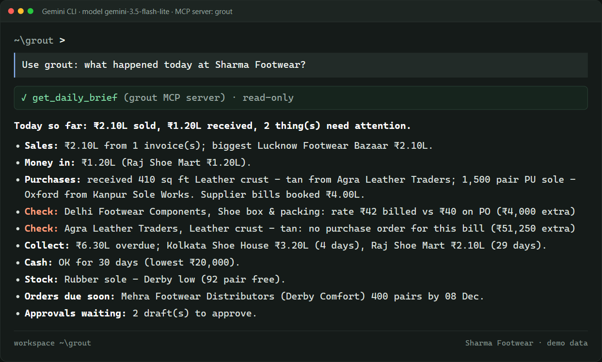

# Grout

*Fills the gaps between your tools.*

Factories already have Tally, Excel and WhatsApp. What's missing is everything in between. Grout fills those gaps:
it reads your books, checks your bills, chases payments, briefs you every morning, and answers any question about
the business in any AI app.



*Gemini asking Grout for today's brief (demo data). Every number comes from Grout's engine, not the AI.*

**An MCP server that gives any AI app (Claude, Gemini, ChatGPT, Cursor…) the brain of a small manufacturing business.**
It combines a business core (sales, stock, money, people), an **industry pack** (leather footwear first) and
the **business's own data** (Tally / Excel). Through MCP tools the AI can **Ask, Simulate, Act and Build**.

> ChatGPT on its own *guesses* "about ₹1.8L profit". Grout *computes* ₹1,80,560 and shows where every rupee came from.

## Why it's trustworthy

| Rule | How it's enforced |
|---|---|
| The AI never does maths | Every number comes from pure, unit-tested functions in `engine/` |
| Every number has sources | Each result lists its inputs, e.g. `materials.Leather crust - tan (seed 2026-11-23)`, `leather_footwear pack default: cutting_wastage_pct` |
| Says when it's guessing | `assumptions` lists inputs still on generic industry defaults |
| Read-only by default | Ask / Simulate / Build never write business data |
| The AI can't approve itself | Act tools create drafts. The human approves via an in-chat form (MCP elicitation) or a 6-digit code shown **only** to the owner |
| Everything audited, everything undoable | Every call (including denied ones) writes `audit_log`; `undo_action` reverses executed drafts |

## Quick start (Windows / macOS / Linux)

```powershell
pip install uv                       # if you don't have uv
cd industryos
uv sync
uv run python -m seed.sharma_footwear  # demo data in data/industryos.db
uv run pytest -q                       # 24 tests
uv run python demo.py                  # runs the whole demo and prints each tool's output
uv run fastmcp run server.py           # stdio server
```

(If `uv` isn't on your PATH after `pip install uv`, use `python -m uv …` instead.)

## Automating the boring work (connect → sync → brief → act)

Grout plugs into the software a factory already uses, so nobody types data twice:

1. **Connect**: Tally Day Book exports dropped into `inbox/tally/` are synced every minute (or live from Tally
   Prime's port 9000 via `connectors/tally_live.py`; Excel/CSV via the importers).
2. **Sync**: each voucher does its job: sales → invoice, money in → marks invoices paid, goods received → stock +
   PO received, supplier bill → recorded for checking, money out → bank balance.
3. **Automations** (`automations/jobs.py`, run by the Console in the background or `uv run python -m automations.run`):
   - **Morning brief** at 09:00: yesterday's sales, money in, purchases, bill problems, overdue money, cash risk,
     low stock, approvals waiting, sent to the owner's WhatsApp (outbox).
   - **Supplier bill check** every 10 min: order vs delivery vs bill; drafts a credit-note query when they differ.
   - **Payment chasing** at 10:00: drafts reminders for customers past the limit (30 days by default).
4. **Ask the AI**: `get_daily_brief`, `what_happened`, `check_purchase_bills`, `sync_tally`, `run_automation`.

Live demo: Console → **Connections** → "Demo: accountant exports today's Day Book" (or upload any Tally XML). Today's
brief, purchases, cash and approvals update instantly. The seed writes that day book to
`seed/files/generated/tally_daybook_<date>.xml`.

## Grout Console (the owner's web app)

```powershell
uv run uvicorn console.app:app --port 8100     # open http://localhost:8100
```

Same database and engine as the MCP server, so the app and the AI never disagree. Screens: **Today** (what needs
you + 4 KPIs), **Approvals** (Approve / Reject / Undo the AI's drafts), **Check new order** (verdict, profit,
stage-load bars, Draft PO), **Orders**, **Production** load, **Stock & purchasing**, **Cash & receivables**
(Send reminder), **Activity log** (people and AI). Pages refresh themselves when the AI drafts or approves something,
so on stage you can put Claude on the left and the Console on the right. Add
`"INDUSTRYOS_CONSOLE_URL": "http://localhost:8100"` to the Claude Desktop `env` so drafts go to the Console
instead of popping up an approval-code page.

## Connect to Claude Desktop

Settings → Developer → Edit config, then add (replace `C:\\path\\to\\grout` with where you cloned it):

```json
{
  "mcpServers": {
    "grout": {
      "command": "C:\\path\\to\\grout\\.venv\\Scripts\\python.exe",
      "args": ["C:\\path\\to\\grout\\server.py"],
      "env": { "INDUSTRYOS_ROLE": "owner", "INDUSTRYOS_CONSOLE_URL": "http://localhost:8100" }
    }
  }
}
```

On macOS/Linux use `.venv/bin/python`. Fully quit and reopen Claude Desktop; you should see the 25 Grout tools.

## Connect to Gemini CLI

Copy `.gemini/settings.example.json` to `.gemini/settings.json`, fix the two paths, then run `gemini` in this
folder and choose **Trust folder**. Sign in with a Gemini API key (from aistudio.google.com/apikey), pick a
Flash model with `/model`, and ask: *"Use grout: what happened today at Sharma Footwear?"*

## Remote clients (streamable HTTP)

```powershell
uv run fastmcp run server.py --transport http --host 0.0.0.0 --port 8000
```

Then connect a client to `http://<host>:8000/mcp`. Put real auth in front before exposing it publicly
(the role today comes from `INDUSTRYOS_ROLE`, which is **not** security).

## Point it at Supabase

1. Copy `.env.example` to `.env` and set `DATABASE_URL` to the Supabase Postgres URI
   (Project Settings → Database → Connection string). Add `psycopg[binary]`: `uv add "psycopg[binary]"` and use
   `postgresql+psycopg://...`.
2. `uv run python -m seed.sharma_footwear` creates the tables and demo data there,
   or paste `supabase/migrations/0001_init.sql` into the Supabase SQL editor.
3. Regenerate the SQL after model changes: `uv run python -m db.export_sql`.
4. Turn on row-level security per `business_id` before a second business shares the database (example in the SQL file).

## The 2-minute demo (Sharma Footwear, Agra)

Before going on stage: `uv run python -m seed.sharma_footwear` (resets the data). The demo is tuned for a due date
about 2–3 weeks out (the seed prints the exact date: the 10th of next month). To rehearse on a fixed date, set
`INDUSTRYOS_TODAY=2026-11-23` in the Claude Desktop `env`.

1. **"Raj Shoe Mart wants 2,000 Oxford Classics by 10 December. Can we take it?"**
   → *Feasible with 1 extra shift (bottleneck: stitching). Leather crust - tan short by 397 sq ft (₹47,608).
   Estimated profit ₹1.81L.* Ask "where did that number come from?" to show the sources and the 7 inputs still on
   industry defaults.
2. **"Order the leather."** → draft PO to Agra Leather Traders, status *pending*. An approval page with a
   6-digit code pops up on the owner's screen; the AI does **not** know the code.
3. **Owner reads the code to Claude** → PO approved and "sent" (outbox), audited.
4. **"Check the order again."** → the shortfall is gone (the engine counts leather on approved POs, like MRP).
5. **"What if we quote 3% higher?"** → profit ₹1.81L → ₹2.47L.
6. **"How's cash?"** → *Cash goes NEGATIVE on 29 Nov*; **"Who owes us?"** → Raj Shoe Mart ₹3.30L overdue →
   **"Send them a reminder"** (another approval).
7. **"Show me the dashboard."** → live dashboard opens with the audit trail.
8. **Platform moment:** "Switch to the laminate industry" → `select_industry("laminate")`. Same tools, new
   industry, zero code: the pack is one YAML file (`packs/laminate.yaml`).

Live import: "Import seed/files/tally_export.xml and seed/files/stock_and_parties.xlsx" → new customers,
supplier, stock items and invoices found, with the column mapping explained.

Owner's approval console (alternative to reading the code): `uv run python -m control.approvals`
(lists pending actions with codes) and `uv run python -m control.approvals approve <id>`.

## What's inside

```
server.py            FastMCP app: tools, resources, prompts
engine/              pure maths: costing, capacity, stock (MRP-style), cashflow, what-if, Indian number format
packs/               industry packs (YAML) + Pydantic schema; leather_footwear.yaml, laminate.yaml
importers/           Tally XML, Excel/CSV, header-synonym column mapper
control/             roles + @requires, @audited, approvals (elicitation / code), execute / reject / undo
tools/               onboard, ask, simulate, act, build (+ data.py: DB rows -> engine inputs with sources)
ui/                  dashboard + tracker Jinja templates (also exposed as MCP Apps ui:// resources)
seed/                Sharma Footwear demo + sample Tally XML and Excel
tests/               engine, tools (in-memory MCP client) and the demo scenario
```

**Tools (20):** Onboard `select_industry`, `import_business_data`, `get_profile_gaps`, `confirm_profile` ·
Ask `true_cost_per_unit`, `stock_status`, `receivables`, `cash_forecast`, `list_pending_actions`, `get_audit_log` ·
Simulate `check_order_feasibility`, `what_if` · Act `draft_purchase_order`, `draft_invoice`, `send_payment_reminder`,
`approve_action`, `reject_action`, `undo_action` · Build `create_dashboard`, `create_tracker`.

**Resources:** `business://profile`, `business://summary`, `industry://{pack}/process`, `industry://{pack}/glossary`,
`ui://industryos/dashboard`, `ui://industryos/tracker`. **Prompts:** `onboard`, `quote_order`, `month_end_close`, `daily_brief`.

**Roles:** viewer = Ask · manager = + Simulate, Build · accountant = + onboarding, invoices, reminders (and approving those) ·
owner = everything, including purchase orders.

## Known limits (honest list for judges)

- Role comes from an env var, not real auth. Next: Supabase Auth + row-level security.
- "Sending" writes to an `outbox` table only; no real email/WhatsApp.
- Capacity is aggregate hours per stage (no detailed scheduling); one average size per product (no size runs yet).
- Standards in the pack are a checklist of data, not legal advice; GST rate is a default to verify with a CA.
- Next up: job work (outsourcing) as a capacity option, payments table, live Tally sync, WhatsApp.
